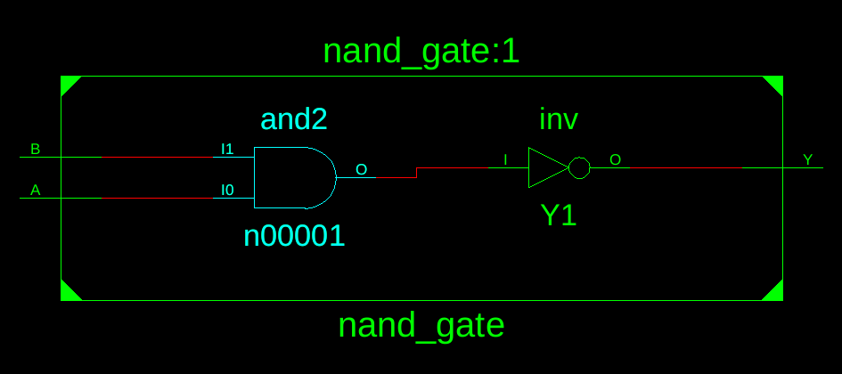
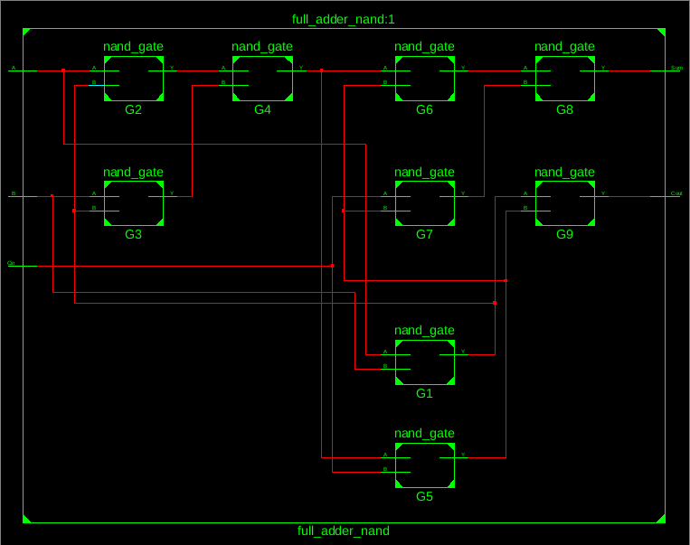
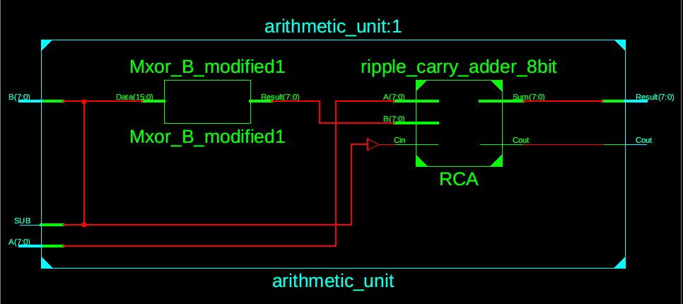
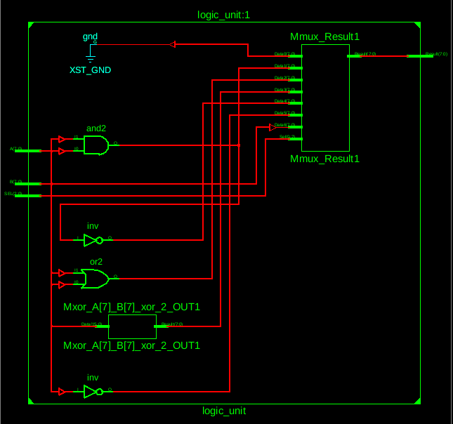
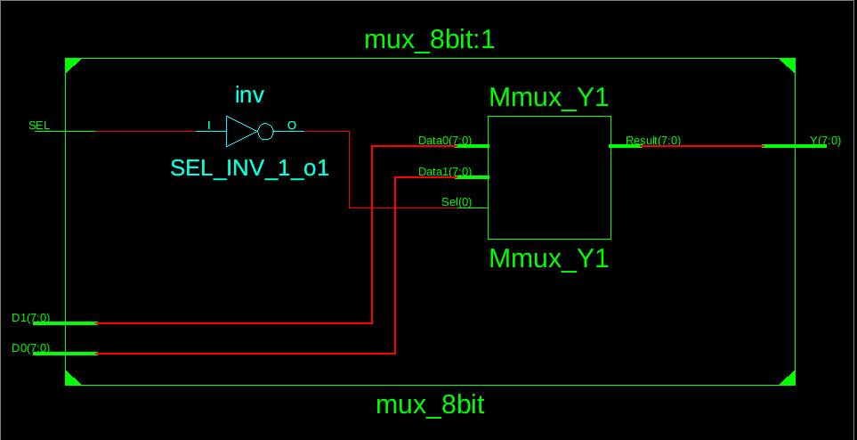
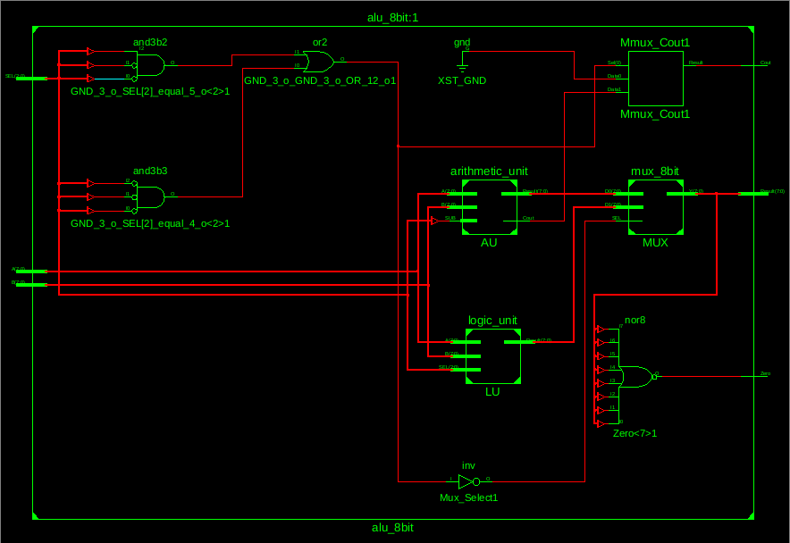
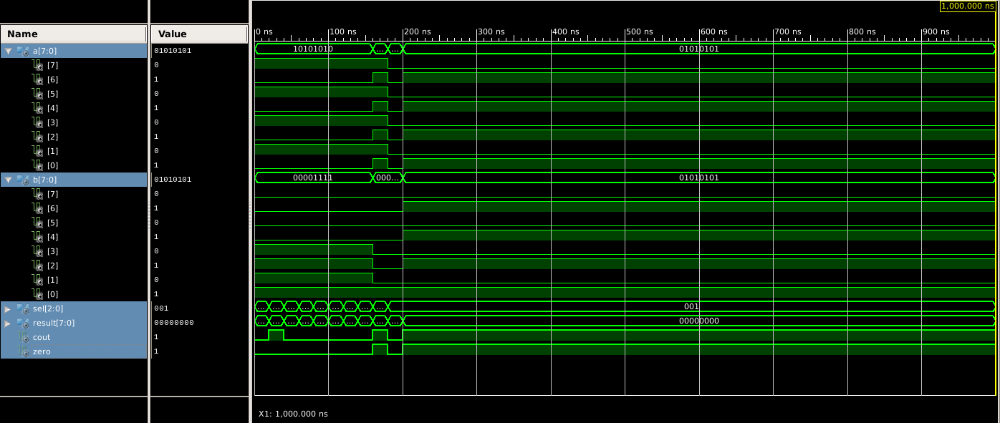
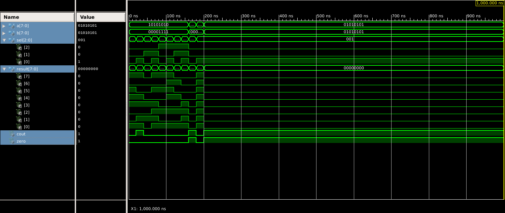

# 8-Bit ALU Design Using VHDL

## Project Overview

This project presents the design and implementation of an **8-bit
Arithmetic Logic Unit (ALU)** using VHDL in Xilinx ISE. The ALU performs
eight arithmetic and logical operations on two 8-bit binary inputs.

The design follows a **hierarchical and modular architecture**, where
individual components are developed and tested separately before being
integrated into the complete ALU. The 1-bit Full Adder is constructed
using NAND gates, and eight Full Adders are connected to create an 8-bit
Ripple Carry Adder (RCA).

The project also includes a testbench to verify the functionality of all
supported operations through simulation.

## Objectives

-   Design a 2-input NAND gate using VHDL.
-   Construct a 1-bit Full Adder using NAND gate instances.
-   Implement an 8-bit Ripple Carry Adder using eight 1-bit Full Adders.
-   Develop arithmetic and logical units.
-   Integrate the components to construct a complete 8-bit ALU.
-   Verify the design using a VHDL testbench and simulation waveforms.

## Features

-   8-bit input operands (`A` and `B`).
-   Eight arithmetic and logical operations.
-   NAND-based 1-bit Full Adder implementation.
-   8-bit Ripple Carry Adder architecture.
-   Addition and subtraction using 2's complement.
-   Modular and hierarchical VHDL design.
-   Zero and Carry output flags.
-   Functional verification using a testbench.

## Supported ALU Operations

The ALU uses a 3-bit selection input (`SEL`) to determine the operation.

  SEL     Operation   Description
  ------- ----------- ------------------------------
  `000`   ADD         Adds A and B
  `001`   SUB         Subtracts B from A
  `010`   AND         Performs bitwise AND
  `011`   OR          Performs bitwise OR
  `100`   XOR         Performs bitwise XOR
  `101`   NAND        Performs bitwise NAND
  `110`   NOT A       Performs bitwise NOT on A
  `111`   PASS B      Passes input B to the output

## Output Flags

-   **Cout (Carry Output):** Represents the final carry from addition.
    During subtraction, it indicates whether a borrow did not occur (`1`
    = no borrow, `0` = borrow). For logical operations, it is set to
    `0`.
-   **Zero:** Becomes `1` when the ALU result is `00000000`; otherwise,
    it remains `0`.

## Tools and Technologies

-   **Hardware Description Language:** VHDL
-   **Design and Synthesis:** Xilinx ISE Design Suite
-   **Simulation:** ISim
-   **Design Approach:** Structural and Behavioral VHDL
-   **Implementation:** Hierarchical modular design

## Project Directory Structure

``` text
ALU_8bit/
├── src/
│   ├── nand_gate.vhd
│   ├── full_adder_nand.vhd
│   ├── ripple_carry_adder_8bit.vhd
│   ├── arithmetic_unit.vhd
│   ├── logic_unit.vhd
│   ├── mux_8bit.vhd
│   └── alu_8bit.vhd
│   └── tb_alu_8bit.vhd
├── screenshots/
│   ├── nand_gate.png
│   ├── full_adder_nand.png
│   ├── ripple_carry_adder_8bit.png
│   ├── arithmetic_unit.png
│   ├── logic_unit.png
│   ├── mux_8bit.png
│   ├── alu_8bit.png
│   └── tb_alu_8bit_1.png
│    └── tb_alu_8bit_2.png
└── README.md
```

## System Architecture and Schematic Diagrams

The complete ALU is developed through several smaller modules. The
following sections are reserved for the corresponding schematic
screenshots generated using Xilinx ISE. Add your screenshots to the
`screenshots/` directory using the filenames shown below.

### 1. NAND Gate

The NAND gate is the fundamental building block used in the Full Adder
implementation. It accepts two single-bit inputs and produces their NAND
output.



### 2. 1-Bit Full Adder Using NAND Gates

The 1-bit Full Adder is constructed using nine NAND gate instances. It
performs binary addition of inputs A, B, and Cin to generate Sum and
Cout.



### 3. 8-Bit Ripple Carry Adder

The 8-bit Ripple Carry Adder is designed by connecting eight NAND-based
Full Adders in series. The carry output of each stage is connected to
the next stage to perform 8-bit binary addition.


### 4. Arithmetic Unit

The Arithmetic Unit performs both addition and subtraction by reusing
the 8-bit Ripple Carry Adder. Subtraction is implemented using the 2's
complement method by conditionally inverting B and setting the initial
carry input.



### 5. Logic Unit

The Logic Unit performs bitwise logical operations, including AND, OR,
XOR, NAND, NOT A, and PASS B. The required operation is selected using
the 3-bit selection input.



### 6. 8-Bit Multiplexer

The 8-bit Multiplexer selects between the arithmetic result and the
logical result. Its selection signal determines which unit's output is
forwarded to the final ALU output.



### 7. Complete 8-Bit ALU

The complete ALU integrates the Arithmetic Unit, Logic Unit, and
Multiplexer. It generates the final 8-bit result along with the Carry
and Zero flags.



## Simulation and Verification

A dedicated testbench, `tb_alu_8bit.vhd`, is developed to verify the
functionality of the complete ALU.

The testbench applies different input combinations and selection codes
to test all eight operations. It also checks important arithmetic
conditions, including carry generation, subtraction with and without
borrow, and zero-result detection.

### Simulation Waveform

The following section is reserved for the simulation waveform screenshot
generated using ISim.




### Test Cases

  Test Case   Operation   Input A   Input B   Expected Result
  ----------- ----------- --------- --------- -----------------
  1           ADD         `AA`      `0F`      `B9`
  2           SUB         `AA`      `0F`      `9B`
  3           AND         `AA`      `0F`      `0A`
  4           OR          `AA`      `0F`      `AF`
  5           XOR         `AA`      `0F`      `A5`
  6           NAND        `AA`      `0F`      `F5`
  7           NOT A       `AA`      ---       `55`
  8           PASS B      `AA`      `0F`      `0F`
  9           ADD         `FF`      `01`      `00`
  10          SUB         `00`      `01`      `FF`
  11          SUB         `55`      `55`      `00`

All test cases are designed to validate the arithmetic and logical
functionality of the ALU, including the behavior of the output flags.

## Challenges Faced

During the development of this project, several challenges were
encountered:

-   Constructing a Full Adder using only NAND gate instances.
-   Connecting multiple Full Adder modules correctly to create the
    Ripple Carry Adder.
-   Implementing subtraction using the 2's complement method.
-   Integrating arithmetic and logical operations through a multiplexer.
-   Resolving VHDL compilation issues related to reading an `out` port
    inside the architecture.
-   Generating and verifying the hierarchical schematic diagrams in
    Xilinx ISE.

These challenges were addressed through modular development, simulation,
debugging, and verification of individual components.

## How to Run the Project

1.  Clone or download this repository.
2.  Open Xilinx ISE Design Suite.
3.  Create or open a VHDL project.
4.  Add all source files from the `src/` directory.
5.  Set `alu_8bit.vhd` as the top-level module.
6.  Add `tb_alu_8bit.vhd` as the simulation testbench.
7.  Select the ISim simulator.
8.  Run the behavioral simulation.
9.  Observe the output signals `Result`, `Cout`, and `Zero` in the
    waveform window.

## Expected Result

The designed 8-bit ALU performs all eight specified arithmetic and
logical operations. Its modular architecture allows each component to be
designed, simulated, and verified independently before integration into
the complete system.

## Repository Information

This repository contains the complete VHDL source code, testbench, and
schematic/simulation screenshots associated with the 8-bit ALU project.

-   **Project:** 8-Bit Arithmetic Logic Unit (ALU)
-   **Language:** VHDL
-   **Development Environment:** Xilinx ISE Design Suite
-   **Simulation Tool:** ISim

------------------------------------------------------------------------

*Developed as part of a VLSI / Digital Logic Design project.*
