# Mini 8-bit Accumulator CPU
**Course:** CSE 450 — VLSI Lab  
**University:** University of Asia Pacific  
**Project:** Final Project — Spring 2026  
**Student ID:** 22201028
**Student Name:** Shourov Chandra Bormon
**Assigned Instruction Set:** Set 8  
**Implementation Language:** VHDL  
**Simulation Tool:** Xilinx ISE  

---

## 1. Project Overview

This project implements a small single-cycle 8-bit CPU in VHDL. The CPU uses a Program Counter (PC), Program ROM, Control Unit, Arithmetic Logic Unit (ALU), Accumulator (ACC), Holding Register (R), and Zero Flag (Z).

The CPU fetches, decodes, and executes one instruction per clock cycle. All sequential state changes occur at the rising edge of the clock. The RESET signal is synchronous and active-high.

The design uses a modular and hierarchical approach. Basic logic gates are constructed using NAND gates, and the arithmetic unit uses NAND-based full-adder components. The complete CPU combines these components with instruction memory, control logic, and clocked registers.

## 2. Assigned Instruction Set

The last digit of Student ID 22201028 is 8. Therefore, the assigned instruction set is **Set 8**.

| Instruction | Opcode | Operation |
|---|---|---|
| LDI imm | `0001` | ACC ← imm |
| ADD imm | `0010` | ACC ← ACC + imm |
| SUB imm | `0011` | ACC ← ACC − imm (modulo 256) |
| STA | `1010` | R ← ACC; ACC remains unchanged |
| LDR | `1011` | ACC ← R |

The CPU implements the two mandatory instructions, LDI and ADD, along with the three Set 8 instructions: STA, LDR, and SUB.

### Instruction Format

Each instruction is 12 bits wide.

- Bits 11–8: 4-bit opcode
- Bits 7–0: 8-bit immediate operand

For STA and LDR, the operand is ignored.

## 3. Project Objectives

The objectives of this project are:

1. To design basic logic gates using NAND gates.
2. To implement a half adder and a full adder using structural VHDL.
3. To construct an 8-bit arithmetic unit supporting addition and subtraction.
4. To implement clocked registers with synchronous, active-high reset.
5. To design a 4-bit Program Counter and a 16-location, 12-bit Program ROM.
6. To implement a Control Unit that decodes the five assigned instructions.
7. To integrate the modules into a complete single-cycle CPU.
8. To verify the Set 8 program using a VHDL testbench and simulation waveforms.

## 4. Hardware Architecture

The main processing sequence is:

```text
Program Counter (PC)
        |
        v
    Program ROM
        |
        v
   Control Unit
        |
        v
  ALU / Data Selection
        |
        v
  ACC / R / Z Registers
```

The Program Counter selects an instruction from the ROM. The Control Unit decodes the opcode and generates control signals. The ALU calculates the addition or subtraction result, while the data-selection logic chooses between the immediate operand, ALU result, and R register value.

The ACC register stores the CPU's current result and is exposed through the output Q. The R register stores data for the STA and LDR instructions. The Z flag indicates whether the value written to ACC is zero.

## 5. Project Folder Structure

```text
CPU_8_bit/
├── screenshots
├── nand_gate.vhd
├── not_gate.vhd
├── and_gate.vhd
├── or_gate.vhd
├── xor_gate.vhd
├── half_adder.vhd
├── full_adder_nand.vhd
├── alu_8bit.vhd
├── program_counter.vhd
├── program_rom.vhd
├── control_unit.vhd
├── acc_register.vhd
├── r_register.vhd
├── z_flag.vhd
│── cpu_top.vhd
├── tb_cpu_top.vhd
└── README.md
```

### Module Descriptions

| Module | Description |
|---|---|
| `nand_gate.vhd` | Implements the universal NAND gate. |
| `not_gate.vhd` | Constructs a NOT gate using a NAND gate. |
| `and_gate.vhd` | Constructs an AND gate using NAND gates. |
| `or_gate.vhd` | Constructs an OR gate using NAND gates. |
| `xor_gate.vhd` | Implements XOR using four NAND gates. |
| `half_adder.vhd` | Adds two single-bit inputs and generates sum and carry. |
| `full_adder_nand.vhd` | Adds A, B, and carry-in using NAND-based logic. |
| `alu_8bit.vhd` | Performs 8-bit addition and subtraction. |
| `program_counter.vhd` | Holds the instruction address and increments after each instruction. |
| `program_rom.vhd` | Stores the Set 8 program in a 16-location ROM. |
| `control_unit.vhd` | Decodes opcodes and generates control signals. |
| `acc_register.vhd` | Stores the 8-bit accumulator value. |
| `r_register.vhd` | Stores an 8-bit value for STA and LDR. |
| `z_flag.vhd` | Stores the zero flag. |
| `cpu_top.vhd` | Connects all CPU modules. |
| `tb_cpu_top.vhd` | Generates clock and reset signals and verifies the program. |

## 6. Set 8 Program ROM

The following instructions are stored in the Program ROM.

| Address | Instruction | Encoded Word |
|---:|---|---|
| 0 | LDI 0x64 | `0x164` |
| 1 | STA | `0xA00` |
| 2 | SUB 0x14 | `0x314` |
| 3 | ADD 0x0A | `0x20A` |
| 4 | STA | `0xA00` |
| 5 | SUB 0x5A | `0x35A` |
| 6 | LDR | `0xB00` |
| 7 | SUB 0x60 | `0x360` |
| 8–15 | NOP | `0x000` |

The ROM output is selected combinationally using the current PC address.

## 7. Reset and Sequential Operation

RESET is synchronous and active-high. At a rising clock edge when RESET is asserted:

| Signal | Reset Value |
|---|---|
| PC | `0` |
| ACC / Q | `0x00` |
| R | `0x00` |
| Z | `1` |

During normal operation, the CPU executes the instruction selected by the current PC and updates the appropriate registers at the rising clock edge.

The Z flag is updated for LDI, ADD, SUB, and LDR. It remains unchanged during STA and NOP.

## 8. Compilation and Simulation

### Compilation Order

Compile the VHDL files in dependency order:

1. `nand_gate.vhd`
2. `not_gate.vhd`
3. `and_gate.vhd`
4. `or_gate.vhd`
5. `xor_gate.vhd`
6. `half_adder.vhd`
7. `full_adder_nand.vhd`
8. `alu_8bit.vhd`
9. `program_counter.vhd`
10. `program_rom.vhd`
11. `control_unit.vhd`
12. `acc_register.vhd`
13. `r_register.vhd`
14. `z_flag.vhd`
15. `cpu_top.vhd`
16. `tb_cpu_top.vhd`

### Simulation Procedure

1. Create or open the Xilinx ISE project.
2. Add all source files in the compilation order above.
3. Select `cpu_top` as the design top module for RTL inspection or synthesis.
4. Add `tb_cpu_top.vhd` and select it as the simulation top.
5. Run behavioral simulation.
6. Observe the clock, reset, PC, Q, R_OUT, and Z signals.
7. Compare the results with the expected Set 8 program trace.

**Note:** The supplied testbench verifies the complete CPU program. Separate module-level truth-table screenshots require appropriate individual testbenches or equivalent module-specific simulations.

## 9. Simulation Results and Expected Outputs

The following values are expected after each rising edge, including the reset edge.

| Cycle | Instruction | ACC / Q | R_OUT | Z | Next PC |
|---:|---|---|---|---:|---:|
| 0 | RESET | `0x00` | `0x00` | 1 | 0 |
| 1 | LDI 0x64 | `0x64` | `0x00` | 0 | 1 |
| 2 | STA | `0x64` | `0x64` | 0 | 2 |
| 3 | SUB 0x14 | `0x50` | `0x64` | 0 | 3 |
| 4 | ADD 0x0A | `0x5A` | `0x64` | 0 | 4 |
| 5 | STA | `0x5A` | `0x5A` | 0 | 5 |
| 6 | SUB 0x5A | `0x00` | `0x5A` | 1 | 6 |
| 7 | LDR | `0x5A` | `0x5A` | 0 | 7 |
| 8 | SUB 0x60 | `0xFA` | `0x5A` | 0 | 8 |

### Expected Final State

- **ACC / Q:** `0xFA`
- **R_OUT:** `0x5A`
- **Z:** `0`
- **PC:** `8` (`1000` in binary)

The testbench should report `ALL SET 8 CPU TESTS PASSED` when all assertions succeed.

---

# 10. Screenshot Evidence

## 10.1 Project Hierarchy and Top-Level Architecture

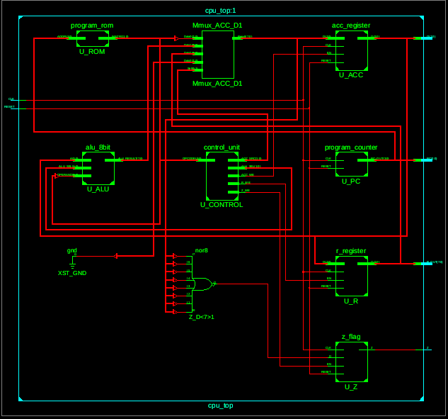

*Figure 1: Project hierarchy and top-level CPU architecture.*

## 10.2 NAND Gate Simulation

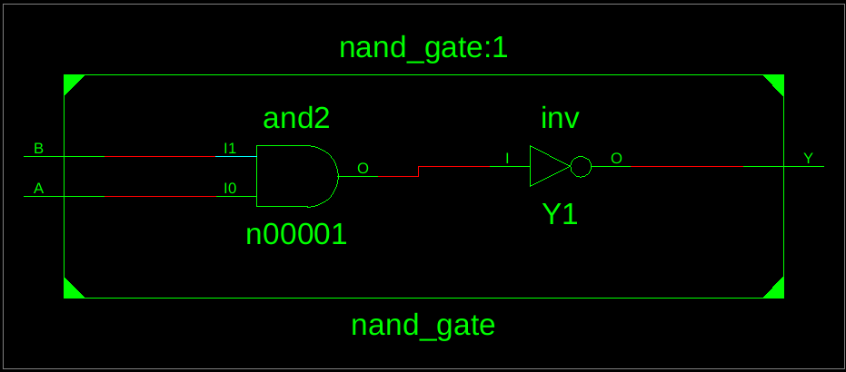

*Figure 2: NAND gate verification.*

## 10.3 NOT Gate Simulation
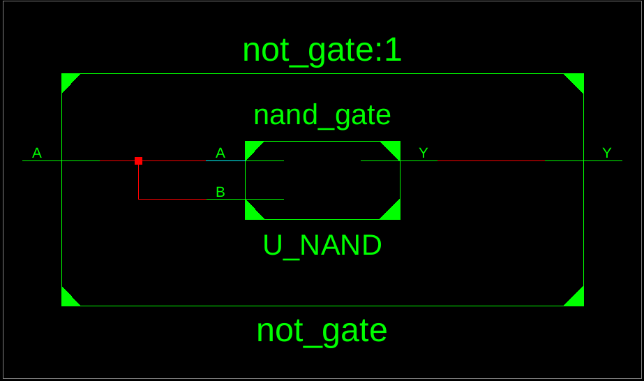

*Figure 3: NOT gate verification.*

## 10.4 AND Gate Simulation
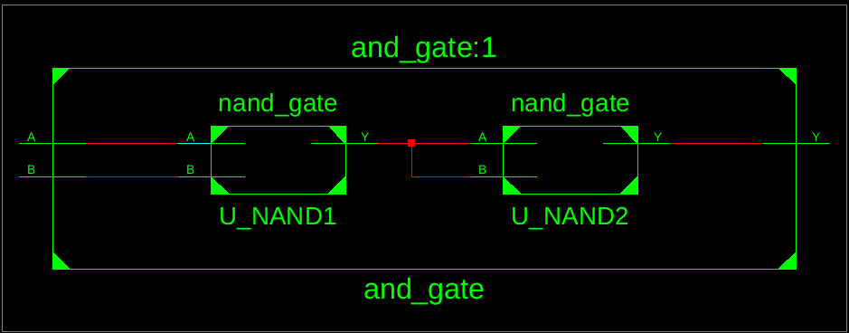

*Figure 4: AND gate verification.*

## 10.5 OR Gate Simulation
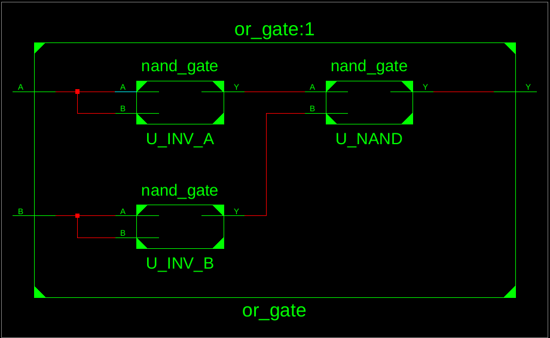

*Figure 5: OR gate verification.*

## 10.6 XOR Gate Simulation
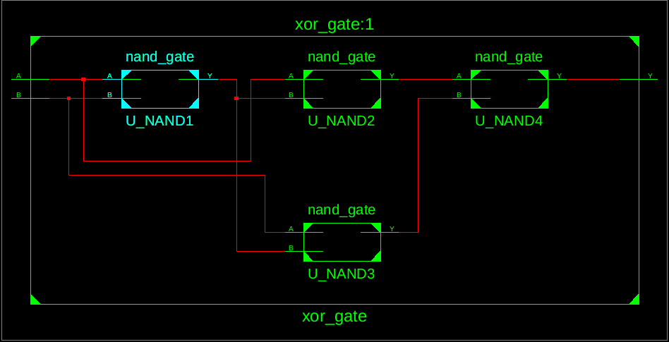

*Figure 6: XOR gate verification.*

## 10.7 Half Adder Simulation

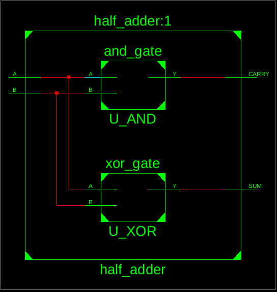

*Figure 7: Half adder sum and carry verification.*

## 10.8 Full Adder Simulation
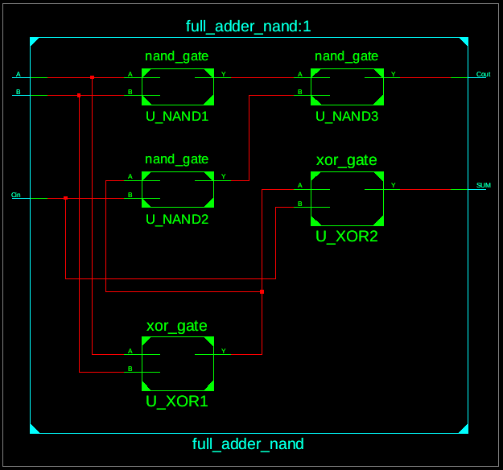

*Figure 8: Full adder sum and carry verification.*

## 10.9 ALU Simulation
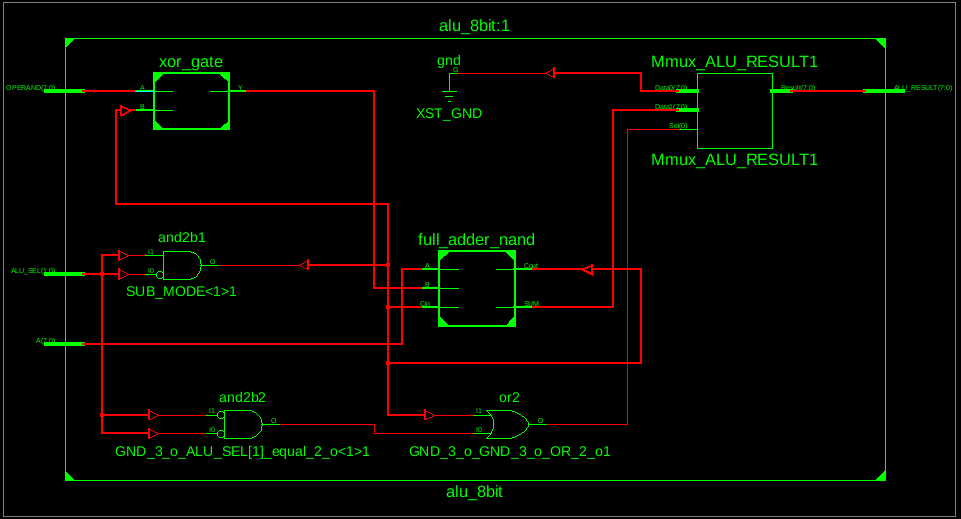

*Figure 9: ALU Simulation Verification.*

## 10.10 Program Counter Simulation
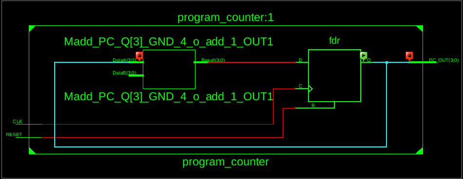

*Figure 10: Program counter simulation verification.*

## 10.11 Program ROM Verification
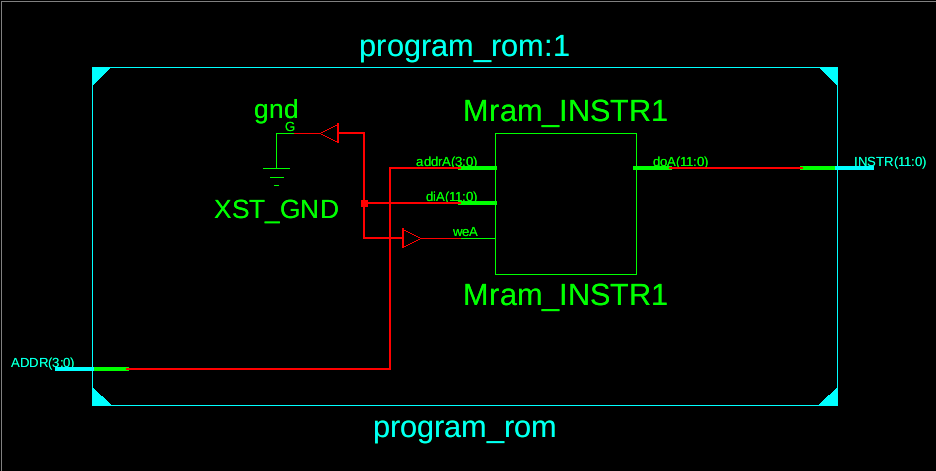

*Figure 11: Program ROM verification.*

## 10.12 Control Unit Verification
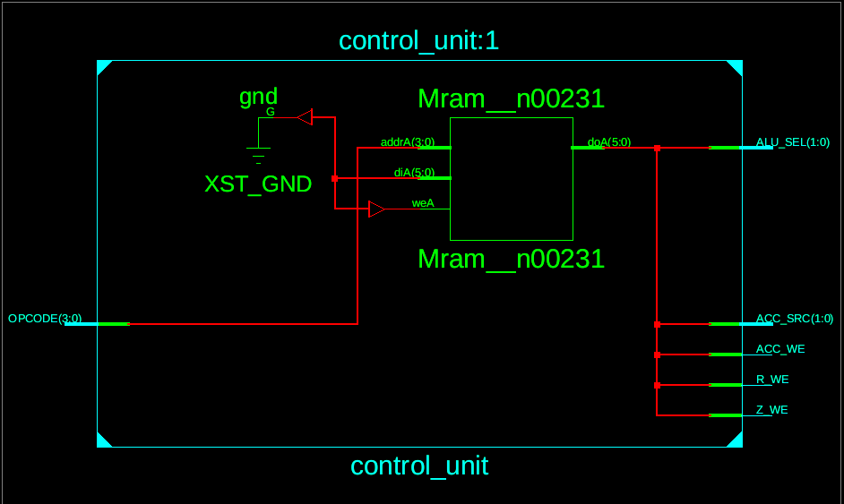

*Figure 12: Control Unit verification.*

## 10.13 ACC Register Verification
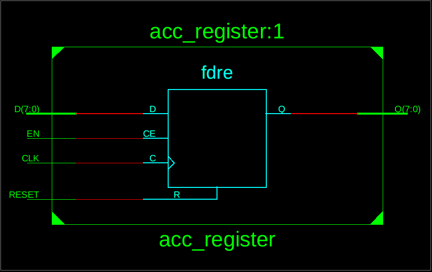

*Figure 13: ACC register reset, write, and hold behavior.*

## 10.14 R Register Verification
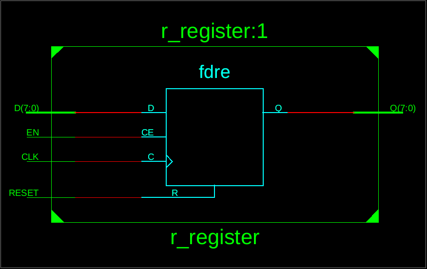

*Figure 14: R register reset, write, and hold behavior.*

## 10.15 Z Flag Verification
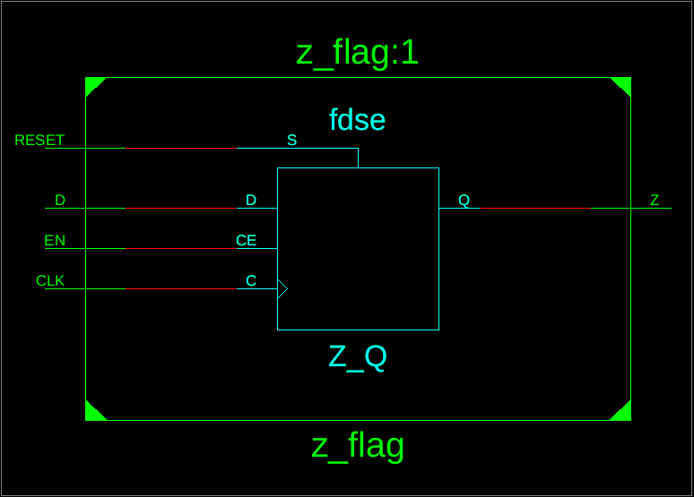

*Figure 15: Z flag verification.*

## 10.16 Top-Level RTL Schematic


*Figure 16: RTL schematic of the integrated Set 8 CPU.*

## 10.17 Testbench Assertion Results
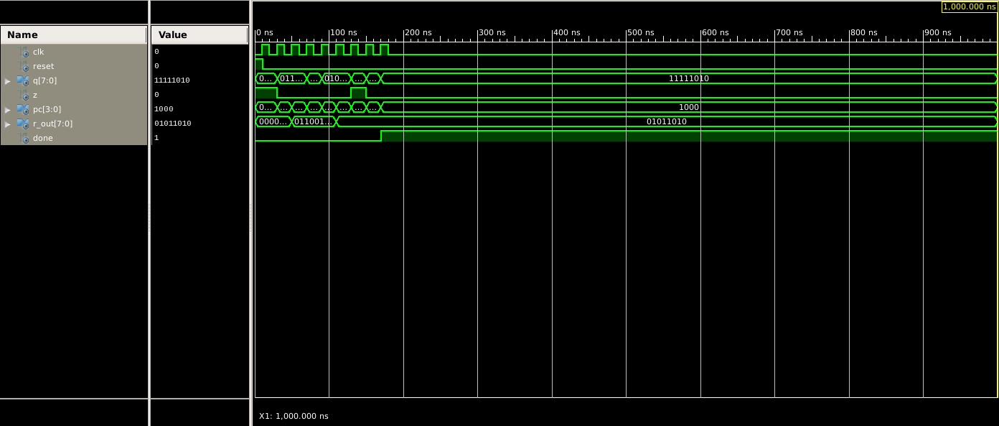

*Figure 17: Successful completion of the Set 8 CPU testbench.*


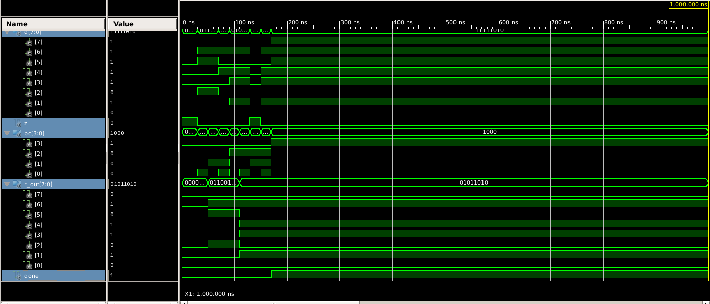

*Figure 18: Successful completion of the Set 8 CPU testbench.*
---

## 11. Challenges Faced
- Correctly connecting structural VHDL components and their ports.
- Handling logic-signal and vector widths.
- Implementing two's-complement subtraction with an 8-bit result.
- Ensuring synchronous reset has priority over register write enables.
- Correctly updating the ACC, R, and Z registers for each opcode.
- Verifying the PC, ROM contents, and output values at rising clock edges.
- Debugging simulation errors and incorrect waveform results.


## 12. Conclusion

This project implements a modular, single-cycle 8-bit CPU in VHDL for the assigned Set 8 instruction set. The design incorporates NAND-based logic components, an arithmetic unit, a Program Counter, a Program ROM, an instruction Control Unit, and the ACC, R, and Z state registers.

The CPU is designed to execute LDI, ADD, SUB, STA, and LDR instructions with synchronous, active-high reset. The testbench checks the required program sequence and the resulting register states.

**Final state after the eight Set 8 instructions:**

- ACC / Q = `0xFA`
- R_OUT = `0x5A`
- Z = `0`
- PC = `8`
